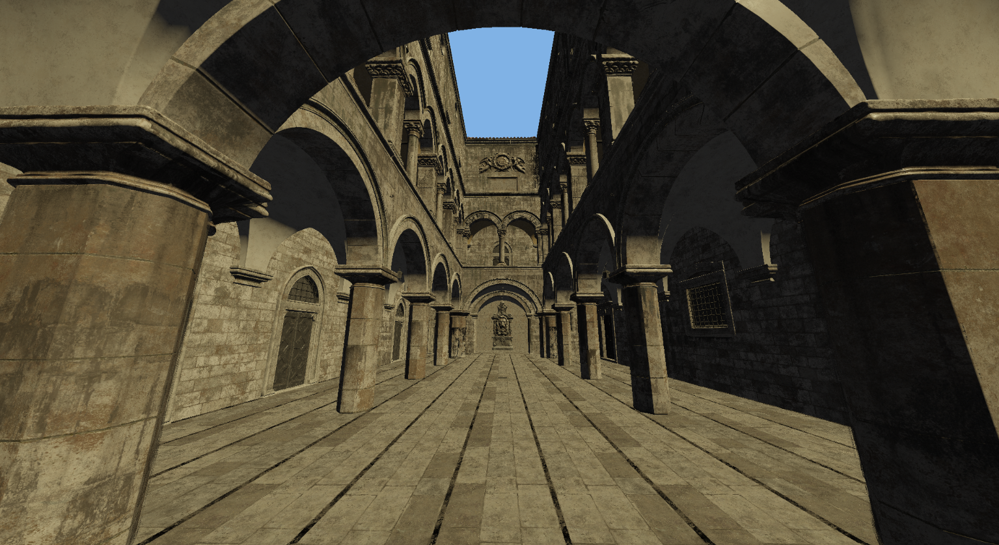

# GLib

GLib is a small game engine developed in C++ with OpenGL. 

## Features

- 3D Rendering
  - Physicaly Based Rendering
  - Multiple light sources
  - Model Loading
- Data driven
  - Entity Component System (ECS)
  - Prebuilt & custom components
- Bullet Physics
- ImGui debug UI



## Building

GLib uses CMake as its build system, to build your application run the following commands in the terminal (Here "Example" is the name of the application):</br>

```
mkdir build
cd build
cmake ..
cmake --build .
cd Example/Debug
.\Example
```

This first creates a folder named `build`, then creates build files and builds the application, and finally it runs the program.